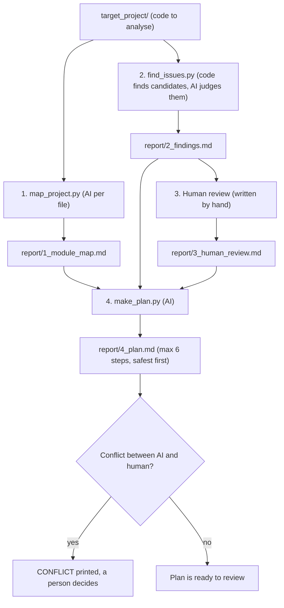

# langchain-legacy-code-archaeologist

A tool that digs through a legacy codebase, flags what to clean up, and never acts on its own. AI suggests, a human verifies, the plan shows any disagreement.

> Learning project (agentic AI, project 2 of 14). Outputs are AI-generated judgments. Verify before changing any code.

## The idea

Human review is **evidence, not a command**. If the human review disagrees with an AI finding, the plan prints `CONFLICT` and shows both sides. No silent winner.

## Workflow



## What each step does

| Step | File | AI or plain code | Output |
|------|------|------------------|--------|
| 1. Map | `src/map_project.py` | AI: one short sentence per file (max 40 files) | `report/1_module_map.md` |
| 2. Find | `src/find_issues.py` | Code finds: files nobody imports, file pairs over 60% similar, `.history/` and `.env` files. AI judges each candidate (issue, risk, suggestion) | `report/2_findings.md` |
| 3. Review | none, written by hand | Human | `report/3_human_review.md` |
| 4. Plan | `src/make_plan.py` | AI, max 6 steps, safest first | `report/4_plan.md` |

Step 2 skips Next.js special files (`page.js`, `layout.js`, `route.js`, `middleware.js`) because they are never imported but still used.

Each finding is a strict pydantic object: `issue`, `risk`, `suggestion`.

## Folder structure

```
src/                  the 3 scripts
target_project/       snapshot of the code being analysed (do not edit)
report/               the 4 reports
requirements.txt
```

`target_project/` is a snapshot. Editing it changes what a re-run finds, and the reports will stop matching.

## Run it

```
pip install -r requirements.txt
export GOOGLE_API_KEY=your_key_here
python src/map_project.py
python src/find_issues.py
# now write report/3_human_review.md
python src/make_plan.py
```

Never commit your real key. Use `export` or a `.env` file that is in `.gitignore`.

### Writing the human review

Each entry needs a claim and its proof. A claim with no proof counts for less. `make_plan.py` looks for lines starting with `- Claim:` and warns if it finds none.

```
## Review 1
- Finding reviewed: ...
- Claim: ...
- Proof: (a command output or a line of code)
- Reviewer: ...
```

## Example from a real run

Target: a Next.js lead-capture app (leaddesk).

- Step 2 flagged `app/admin/page.js` and `app/admin/(dashboard)/page.js` as 95% similar, risk low.
- The AI gave two options and did not pick one. Its first option was to delete the dashboard page.
- Human review: `grep signOut` showed sign out lives in `AdminHeader` in the layout, so `app/admin/page.js` is the older copy.
- Step 4 marked a human check needed and printed `CONFLICT`, showing both sides.
- Decision: delete `app/admin/page.js`, keep the `(dashboard)` version. Not applied, by choice. The report is the deliverable.

## Known limits

- "Unused file" is a simple check: no other file imports its filename. It can be wrong.
- The AI named the route conflict but could not tell which file was the real one. The human did.
- Only 1 finding has been human-reviewed so far. The rest are unchecked.
- Max 40 files mapped, and long files are cut (3000 characters for the map, 6000 for findings).

## Built with

LangChain, Google Gemini, Pydantic